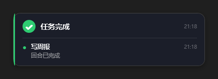
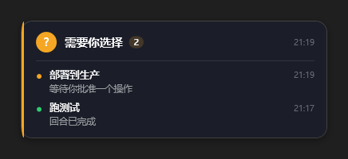
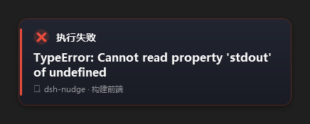
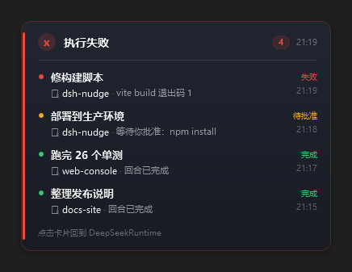
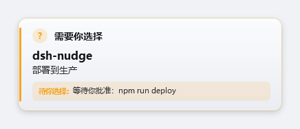
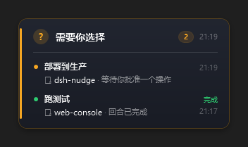

# dsh-nudge

[](https://github.com/HalfDone03/dsh-nudge/actions/workflows/selftest.yml)

DSH（DeepSeek Harness）插件：会话里**任务完成**、**需要你选择**、**执行失败**时，在桌面**右下角**弹一张置顶小卡片。
不抢焦点、不挡输入、到点自己消失；默认点一下回到 DSH 窗口并把这批提醒复制到剪贴板——这两件事都能关掉，
也可以让整张卡**鼠标穿透**，只当提示用。

- **纯 Windows**：卡片是 `powershell.exe -STA` 起的一次性 WPF 进程，不依赖 Electron 的 `Notification`。
- **不打断你**：`WS_EX_NOACTIVATE` 窗口，永不被激活；前台是全屏应用（游戏 / 放映 / 演示）时整批不弹。
- **自带设置页**：`设置 → 提醒弹窗`，九组配置，改完点「应用」立刻生效，不用重启。

## 截图

这些不是效果图，是 `scripts/selftest.mjs` 用**同一个** WPF 渲染器在离屏窗口画出来的快照，
尺寸与像素统计固化在 `tools/snapshot-baseline.json`，版式一改、图没跟着重生就会红。

<table>
  <tr>
    <td align="center"><br><sub>任务完成</sub></td>
    <td align="center"><br><sub>需要你选择</sub></td>
    <td align="center"><br><sub>执行失败</sub></td>
  </tr>
  <tr>
    <td align="center"><br><sub>4 条合并成一张清单</sub></td>
    <td align="center"><br><sub>浅色（<code>theme: light</code>）</sub></td>
    <td align="center"><br><sub>拖到 300 宽：明细折行</sub></td>
  </tr>
</table>

## 什么时候会弹

| 时刻 | 触发来源 | 卡片标题 |
| --- | --- | --- |
| 回合正常结束 | `session/event` → `turn/end`，`reason.kind` 为 `completed` / `max-tokens` | 任务完成 |
| 等你批准或回答 | `approval/request` 事件、`userQuestions.ask()` 被调用 | 需要你选择 |
| 回合或工具失败 | `turn/end` 的 `reason.kind === 'error'`、`tool/result` 报错 | 执行失败 |
| 回合被策略拦截 | `turn/end`，`reason.kind === 'blocked'`（归档会话、过期 goal 等） | 执行失败 |

几条提醒挤在一起时，`mergeWindowMs`（默认 1.2 秒）窗口内的事件合并成一张卡：标题取最严重的那个，
右上角显示累计条数，清单最多列 `maxItems` 条（多的收成「还有 N 条未展开」）。
子代理会话（`delegationDepth > 0` 或有 `parentSession`）不单独弹，避免每个子任务都响一次。

## 安装

**有 Discover 入口就用 A**，没有就走 B / C。

### A. 插件市场一键装（DSH 0.2.1+）

`Plugins → Discover → Index sources → 添加`，粘贴：

```
https://gcore.jsdelivr.net/gh/HalfDone03/dsh-nudge@main/index.json
```

回到 Discover 看到「DSH 轻推提醒」，点安装。市场自己写 profile、跑 pnpm，装完重开 DSH 生效。

索引是标准 format 1，`source` 用 git 提交钉死，所以装到的是 `index.json` 里 `source.commit` 指向的那一版。
换镜像（同一份内容）：`fastly.jsdelivr.net` / `testingcf.jsdelivr.net` / `cdn.jsdmirror.com`，路径一样。

两个坑：

- **别用 `raw.githubusercontent.com`**：国内常年连不上，一条索引读不出来整个 Discover 就是空的；
- **别用 `@v1.6.1`**：jsDelivr 对标签永远返回打标签那一刻的 `index.json`，那份里的 `commit` 还是旧指针。用 `@main`。

### B. 手动安装（有 git）

```powershell
git clone https://github.com/HalfDone03/dsh-nudge.git
cd dsh-nudge

# 只看计划，不写文件
powershell -NoProfile -ExecutionPolicy Bypass -File .\scripts\install.ps1 -DryRun

# 真正安装（会先备份 profile 的 package.json）
powershell -NoProfile -ExecutionPolicy Bypass -File .\scripts\install.ps1
```

### C. 没有 git

下压缩包解压，进目录跑 B 里那两条命令：

```
https://codeload.github.com/HalfDone03/dsh-nudge/tar.gz/refs/heads/main
```

（npm 上装不到：`dsh-nudge` 这个名字已被别人占用。）

### 安装脚本做三件事

1. 往 profile 的 `package.json` 加一条 `file:` 依赖，并把 `dsh-nudge` 追加进 `dsh.profile.bundles`；
2. 用 **DSH 自带的 pnpm** 在 profile 目录跑一次 `pnpm install`，把 `node_modules\dsh-nudge` 落成**目录拷贝**
   （profile 的 `pnpm-workspace.yaml` 是 `nodeLinker: hoisted`）——Host 的 Loader 按包名从 `node_modules` 解析，
   不落盘就是「装了但加载不到」；
3. 校验 `node_modules\dsh-nudge\package.json` 可读，并打印实际版本。

它**不碰** profile 的 `cordis.patch.yml`（那里放部署密钥），也**不会**重启 DSH。

**跑之前先退出 DeepSeek Harness**：pnpm 要重写 `node_modules`，Windows 上被占用的文件删不掉。

DSH 自带 node 与 pnpm，路径因装法而异，脚本挨个试：

| 装法 | 自带 pnpm 的位置 |
| --- | --- |
| 桌面版（安装包） | `<安装目录>\resources\runtime\primary-runtime\dependencies\pnpm\bin\pnpm.cjs` |
| 便携版 / 旧结构 | `%DSH_HOME%\dsh-runtimes\dsh-primary-runtime\dependencies\pnpm\bin\pnpm.cjs` |

安装目录从「运行中的 DSH 进程可执行文件所在目录」和「卸载注册项 `InstallLocation`」两处认；
想直接指定就设 `DSH_NUDGE_INSTALL_ROOT=<安装目录>`。

两处都找不到、`PATH` 里也没有 `pnpm` 时，脚本**把 `package.json` 回滚成备份并以退出码 1 结束**，
不留「manifest 里写了插件、`node_modules` 里没有」的半装状态（那种状态下次启动 DSH 会加载失败）。
`pnpm install` 失败、或跑完仍读不到包，也一样回滚：要么装好，要么像没装过。

### 卸载

```powershell
powershell -NoProfile -ExecutionPolicy Bypass -File .\scripts\uninstall.ps1
```

安装与卸载都幂等；每次改动前生成 `package.json.bak-<时间戳>`，失败自动回滚。

「已经装过」要**三方一致**才算：`package.json` 里有依赖、`node_modules\dsh-nudge` 在、profile 的
`pnpm-lock.yaml` 里也记着这个包。只有前两条不算——旧版脚本手建的 junction pnpm 不认，
profile 里下一次 pnpm 操作会把它当杂物删掉。

### 改完代码怎么让 DSH 用上

profile 里装的是**目录拷贝**，不是链接。所以改完源码必须重新落盘，否则 DSH 跑的还是旧代码：

```powershell
# 退出 DSH 后（pnpm 要重写 node_modules）
powershell -NoProfile -ExecutionPolicy Bypass -File .\scripts\install.ps1
```

只改 `client.js`（设置页）时，直接把它复制进 `node_modules\dsh-nudge\` 再刷新页面即可，不必重装；
只改 `lib/*` 则必须**重启 DSH**（Host 侧模块已被进程缓存）。

## 配置

三个地方都能改，都不用重启：

- **插件自己的设置页**（推荐）：`设置 → 提醒弹窗`，见下一节。
- **`设置 → 插件 → nudge`**：宿主按 `Config` 里的 `.volatile()` 字段自动生成的表单。本包自带设置页，
  已经用 `configure({ auto: false })` 把这张关掉了，免得同一份配置出现两次；想让它回来，
  删掉 `lib/index.js` 里那句 `ctx.inject(["settings"], ...)`。
- **手改 profile 的 `cordis.patch.yml`**，按 id 覆盖默认值（下面就是全部字段）：

```yaml
- id: nudge
  config:
    enabled: true          # 总开关
    staySeconds: 15        # 停留秒数 1..600；「需要你选择」按三倍算（不少于 30 秒）
    margin: 16             # 可见边框距工作区边缘（阴影会多伸出 14px，被屏幕边缘裁掉）
    anchor: bottom-right   # 落点：九宫格里挑一格（top/middle/bottom × left/center/right）
    width: 384             # 卡片宽度 260..900，0 表示用默认 384
    theme: auto            # auto 跟随 Windows 深浅色，也可固定 dark / light
    cardColor: ''          # 卡片底色 #RRGGBB，留空跟随主题
    accentColor: ''        # 左侧竖条颜色，留空按类别（完成绿 / 待选橙 / 失败红）
    rememberPosition: true # 记住拖过的位置与尺寸（高度始终跟内容走）
    placementFile: ''      # 位置记忆文件；留空 = %LOCALAPPDATA%\dsh-nudge\placement.json
    showWhenFocused: true  # DSH 在前台时也弹
    suppressWhenFullscreen: true  # 前台是全屏应用时整批不弹
    mergeWindowMs: 1200    # 合并窗口（毫秒）
    maxItems: 8            # 一张卡最多列几条 1..20
    alertOnToolError: true # 单个工具调用失败也算「失败」提醒
    quietToolErrors: true  # 回合没跑完时的工具报错先攒着（开着时上面那条不生效）
    muteRanges: []         # 静音时段，一行一段，如 ['22:00-08:00']，支持跨零点
    kinds:                 # 三类提醒各自开关
      completed: true
      needs_choice: true
      failed: true
    clickToFocus: true     # 点击卡片回到 DSH 并复制这批提醒
    clickThrough: false    # 鼠标穿透：卡片不接鼠标，点下去落到后面的窗口（纯提示）
    typography:            # 每一类文字的字号与颜色；留空 / 0 用主题默认
      title: { color: '', size: 0 }
      project: { color: '', size: 0 }
      task: { color: '', size: 0 }
      reason: { color: '', size: 0 }
      status: { color: '', size: 0 }
      time: { color: '', size: 0 }
      more: { color: '', size: 0 }
      footer: { color: '', size: 0 }
    visible:               # 卡片上要显示哪几块；关掉的不画也不占位
      title: true
      project: true
      task: true
      status: true
      items: true
      more: true
      footer: true
    debugPreview: false    # 预览卡：常驻、可拖位置、拖边改尺寸
    debugPayload: false    # 把每次弹出的 payload 追加落盘
    debugFile: ''          # 落盘文件；留空 = %TEMP%\dsh-nudge-payloads.jsonl（超 5MB 轮转成 .1）
    popupScript: ''        # 自定义弹窗脚本；留空用包内 lib/popup.ps1（这项不 volatile，改了要重启）
```

非法配置在插件加载时报错（`staySeconds` 越界、`muteRanges` 格式不对等），不会静默失效；
设置页填了非法值时，插件继续沿用上一份能用的配置，不会因为手滑把提醒全关掉。

`popupScript` 是唯一**没**标 volatile 的项：换脚本等于换进程行为，改了必须重启 DSH。

## 设置页

整页九张卡片，按「你多久会动它一次」排：先看长什么样（预览），再调字、卡片、位置，然后才是弹不弹、
点了会怎样、什么时候别弹、怎么合并，最后是排查用的调试。顶部导航吸顶并**亮起当前那一组**；
每张卡片第一行是标题 + 一行「这组现在是什么状态」的小字 + 一颗「恢复默认」。

| 分组 | 里面是什么 |
| --- | --- |
| 预览 | **不是配置项**，没有「恢复默认」：样卡与真卡用同一份配置、同一套尺寸。底边那颗「在桌面上弹一张看看」让真卡出现在桌面（点应用会当场重画）。点样卡上任一行跳到「文字」 |
| 文字 | 8 类文字的字号与颜色：点名字切换，只显示当前那一类。字号框里填的是**现在实际用的值**（改成 0 才回默认），颜色是 11 颗色块 + 一个能写 `#RRGGBB` 的框 |
| 卡片 | 显示哪几块（7 颗开关）、宽度、配色（auto / light / dark）、卡片底色、左侧竖条 |
| 位置与停留 | 落点九宫格、停留秒数、距屏幕边缘、记住拖过的位置 |
| 提醒 | 总开关 + 三类提醒 |
| 点击 | 「点击卡片回到 DSH」与「鼠标穿透（纯提示）」 |
| 什么时候弹 | 前台也弹 / 全屏不打扰 / 中途报错先忍 / 工具报错单独提醒 |
| 合并与静音 | 合并窗口、清单最多几条、静音时段（写错的行当场红字标出，下面还有「现在是否静音」） |
| 调试 | 默认收起：payload 落盘、落盘路径、配置导出 / 导入 |

几处刻意的设计：

- **一组只管一件事**：原来「长这样」一组扛着样卡、字号、宽度、落点、配色、停留、边距十来项，现在拆开了。
- **标题右边有状态摘要**：「宽 384 · 跟随系统」「右下角 · 15s」「三类都弹」「点击回到 DSH」
  「1200ms 内合并 · 最多 8 条」，不用点开就知道现在是什么。
- **应用栏点名改在哪几组**：九组之后光看「N 项改动还没保存」想不起来改在哪，后面跟一排可点的组名，
  点一下跳过去。
- **同一个字段只有一个入口**：预览卡只有「预览」组那颗按钮；`debugPreview` 不在「调试」里再开一个开关。
- **上下级关系会当场说明**：`quietToolErrors` 开着时 `alertOnToolError` 根本不生效（宿主在 `tool/result`
  里直接 return），所以两者都开时那一行的说明变成「上面那条开着，这一条现在不生效」，整行也变淡。
- **两段式「全部恢复默认」**：第一下只上膛（按钮变红、文案变「确认全部恢复」），第二下才把默认值填进草稿，
  落盘仍由「应用」完成，误点还能「放弃」。
- **写回先落草稿**：改任何一格都先进草稿，点「应用」才写；写回只提交与现状不同的项，一个键都没变就不发请求。
  失败会**点名**哪几项宿主没接受（以前是静默回滚），并逐项重试、每次重取最新 revision。

页面底部有 `配置状态：<status> · 可写/只读 · 待保存 N 项`：`unavailable` 说明宿主的设置服务没列出
`nudge` 命名空间，不是页面坏了。最下面一行是 `提醒弹窗设置页 · 修订 <PANEL_REVISION>`——
改完设置页看不到新修订号，说明浏览器还在用旧的客户端包，刷新即可。

## 卡片长什么样

两条路径：只有一条提醒走「单条」，两条以上走「清单」。**两种排版都是项目名最大**——
先看清是哪摊活，再看是哪个任务，最后才是报了什么。

单条：

```
────────────────────────────────────────────
▌ ✖ 执行失败 · 20:09

  dsh-nudge
  修构建脚本
  失败：vite build 找不到入口模块
  点击卡片回到 DeepSeek Harness
────────────────────────────────────────────
```

- 左侧 3px 强调色竖条，颜色跟随类型（完成 `#2ECC71` / 待选择 `#F5A623` / 失败 `#E74C3C`），整张卡外框也泛色；
- 项目名 15.5 半粗（全卡最大、一行截断），任务名 12.5（最多三行），状态 + 原因 10.5；
- 底部那行小字说的是「点一下会怎样」，跟着开关变：`点击卡片回到 DeepSeek Harness` /
  `仅提示 · 点击不跳转，点一下收起` / `仅提示 · 点击穿透，点得到后面的窗口`。

多条：每条三行（项目 → 任务名 → 明细），右侧竖排「状态 + 时间」；明细为空的条目只排两行。

### 排版会自己适应

- **宽度变了**：文字、清单、项目标签按当前宽度重新折行，字号以首次量出的宽度为基准按比例缩放
  （夹在 0.85–1.8 倍），卡片高度跟着内容长。
- **关掉某一块**：剩下的块自动顶上去。每块之间靠**自己的上边距**隔开，所以「顶上那一块」不能带上边距——
  真卡由 `$firstCarrier` 统一清零，样卡是 `.dsh-nudge-card-body > *:first-child{margin-top:0}`。
  离屏实测：全开 / 关项目名 / 关标题+项目名 / 只剩清单 / 只剩底部，五种组合首行都落在同一位置。
- **高度不记忆**：`placement.json` 里只认**宽度**。高度一律跟内容走，否则关掉几块之后底部会留一片空白
  （`tools/probe-remembered.ps1` 验的就是这条：placement 钉死 210px，全开 406×192、关两块 406×140）。
- **逐块拖动已移除**：1.4.0 起卡片只有一种排布，旧的 `blocks.<角色>.dx/dy/w` 会被忽略并丢掉。

## 交互

- **可拖、可缩放、记得住**：按住卡身换位置，拖四边/四角改大小（最小 260×118）。没动过就贴 `anchor`
  指定的角落；动过就把坐标记进 `%LOCALAPPDATA%\dsh-nudge\placement.json`，下次回到那儿。
  记的位置已经不在任何显示器上（拔副屏、改分辨率）时自动回落到角落；删掉文件即恢复默认。
- **点一下**：默认把提醒来源的那个 DSH 窗口切到前台，并把提醒内容（标题 + 明细）放进剪贴板。
  Web GUI 是单页应用，没有「按会话 id 直达」的 URL，所以只能聚焦窗口 + 复制线索。
  剪贴板可能被别的程序占着，关窗时补一条 `{"type":"closed","reason":"clicked","clipboard":true|false}`，
  日志里能看见到底写没写成。
- **不想跳转**：关掉「点击卡片回到 DSH」后，点一下只是把卡片收起来（不切前台、不写剪贴板），
  关闭原因写 `clicked-nojump`。
- **纯提示**：打开「鼠标穿透」后整张卡挂 `WS_EX_TRANSPARENT`，点下去落到后面的窗口上。
  代价是不能拖、不能右键关，只能等停留时间到；预览卡例外（它就是为了被摆位）。真机探针
  `tools/probe-passthrough.ps1` 用 `WindowFromPoint` 验过：普通卡命中卡片自己，穿透卡命中它后面的窗口。
- **预览卡原地重画**：改一格设置点「应用」，桌面上那张预览卡在 ~0.3 秒内自己重建内容——
  宿主把新 payload 写进卡片轮询的文件，卡片每 250ms 看一次，变了就重建正文并调窗口高度，
  **进程、窗口、位置、尺寸都不动**。走「关掉再弹一张」的话，光 PowerShell + WPF 冷启动就要 ~900ms。
- **同一时刻只有一张卡**：`Local\dsh-nudge-card` 互斥量选主，后来者 Set 一下 `Local\dsh-nudge-replace`
  把在位那张请走（200ms 轮询、UI 线程上关窗），再接管位置。拿不到命名对象时退回「每批一张」，不会因此不弹。
- **全屏不打断**：先问系统「现在适合打扰吗」（`SHQueryUserNotificationState`），再看前台窗口是否正好盖满
  物理屏。桌面本身（`Progman` / `WorkerW`）、任务栏、最大化窗口都不算全屏。两道检查都是只读查询：
  不挂钩子、不抓输入、不碰游戏窗口。
- **不抢焦点**：`WS_EX_NOACTIVATE`，永不被激活；指针移动超过 4px 才开始拖动，纯点击不进入系统拖动循环；
  弹出后 320ms 内落下的点击会被忽略。
- **停留**：`staySeconds` 起，条目越多越久（`staySeconds + 2 × (条数-1)`），「需要你选择」再乘三且不少于 30 秒；
  另有硬上限（`staySeconds × 4 + 30` 秒）的 watchdog，连 `Close()` 都失败时走 `forceQuit` 强制退出。

## 版本

当前 **1.6.1**（2026-11-13）。逐条改动看 [CHANGELOG.md](CHANGELOG.md)，
带说明的发布记录在 [Releases](https://github.com/HalfDone03/dsh-nudge/releases)。

| 版本 | 日期 | 一句话 |
| --- | --- | --- |
| 1.6.1 | 2026-11-13 | 记住的尺寸只留宽度，高度跟着内容走（关掉几块不留白） |
| 1.6.0 | 2026-11-10 | 关掉某块后内容自己顶上；预览卡改设置原地重画（~0.3s） |
| 1.5.2 | 2026-11-10 | 导航亮起当前那一组；页尾加「全部恢复默认」（点两下） |
| 1.5.1 | 2026-11-10 | 隐患审计：设置页失败会说话了，宿主四条兜底，弹窗强制收场 |
| 1.5.0 | 2026-11-10 | 设置页重排成九组，一组只管一件事，标题带状态摘要 |
| 1.4.0 | 2026-11-10 | 卡片里不再能逐块挪位置：只有尺寸可调，内容自己排 |
| 1.3.0 | 2026-11-10 | 点击行为可配：关掉跳转、或整张卡鼠标穿透，只当提示 |
| 1.2.4 | 2026-11-10 | 设置服务出错会把整个 DSH 带崩 |
| 1.1.0 | 2026-11-02 | 设置页重做：样卡调字号颜色、预览卡能拖位、装卸脚本更稳 |
| 1.0.0 | 2026-10-29 | 定版：接口冻结，此后只修 bug 发补丁版 |
| 0.3.3 | 2026-10-28 | 配置进设置、插件自带设置页、预览开关，弹窗更快 |
| 0.3.1 | 2026-10-26 | CI、快照像素基线与一条命令发版 |
| 0.3.0 | 2026-10-26 | 版式「项目 > 任务 > 原因」、默认停留 15 秒、全屏不打扰、同一时刻只留一张卡 |
| 0.2.1 | 2026-10-24 | 工具失败按 `message.isError` 判定、审批卡片带上下文、标题走 `sessionTitle` 服务 |
| 0.2.0 | 2026-10-23 | 卡片跟随 DSH 所在屏幕、右键只关闭、不抢焦点与拖动缩放 |
| 0.1.0 | 2026-10-22 | 首版：三种时刻各弹一张置顶卡片，点击聚焦 DSH 并复制摘要 |

## 自测与探针

```powershell
# 全量：278 项，含真起窗口、双卡抢槽位、预览原地重画
node scripts/selftest.mjs

# CI 跑这个：255 项，跳过需要交互桌面的两段
node scripts/selftest.mjs --no-live

# 改了版式、确认新样子对了之后，重生像素基线
node scripts/selftest.mjs --update-baseline
```

`PATH` 里没有 node 时，用和装/卸脚本同一套「找 DSH 自带 node」的逻辑：

```powershell
. .\scripts\dsh-deps.ps1
$node = (Find-DshDependencies).Node
if (-not $node) { $node = 'node' }
& $node .\scripts\selftest.mjs
```

覆盖：配置校验与默认值、实时配置（改完点应用就生效）、静音时段（含跨零点）、事件合并计数、严重度排序、
三类开关、真起弹窗并收到 `{"type":"shown"}`、dispose 后无孤儿进程、离屏快照与像素基线比对，
以及一组源码静态约束（`popup.ps1` 必须纯 ASCII、字号阶梯、单卡槽位、剪贴板回报、全屏抑制两道判断、
预览原地重画链路、首块不吃上边距……）。

设置页那部分是**离线**跑的：用 `node:vm` 造一个假 `window.__ModuleLoader__` 把 `client.js` 加载起来，
再用假 React 调它的 factory 与页面组件，断言九组的 id / 顺序 / 标题 / 恢复默认、导航与分组一一对应、
应用栏点名分组、点两下的全部恢复默认、控件数量与写回路径。所以浏览器半身坏了不用真开 DSH 就能发现。

**真机探针**（`tools/`，都是纯 ASCII 的 PowerShell，直接跑）：

| 探针 | 验什么 |
| --- | --- |
| `probe-reflow.ps1` | 扫六个宽度，断言高度跟着宽度变、同宽度两次结果一致，且只有一个窗口 |
| `probe-inplace.ps1` | 改 payload 文件后卡片原地重画：同 pid、同 hwnd、高度变了、`shown` 只有一行 |
| `probe-remembered.ps1` | placement 里钉死 210px 高度，全开 406×192、关两块 406×140（宽度保留、高度跟内容） |
| `probe-click.ps1` | 真点一下「不跳转」的卡：`reason=clicked-nojump`、`clipboard=false`、前台没变 |
| `probe-passthrough.ps1` | 穿透卡 `WindowFromPoint` 命中它后面的窗口；普通卡命中自己 |
| `probe-rotate.mjs` | 调试 JSONL 超 5MB 轮转成 `.1`，新文件只写这一条 |

想看卡片上到底写了什么（比如怀疑标题取错）：

```powershell
$env:DSH_NUDGE_DEBUG_PAYLOAD = "1"
$env:DSH_NUDGE_DEBUG_FILE = "$env:TEMP\nudge-payloads.jsonl"   # 可省略
```

之后每次弹卡追加一行 `{at, payload}`；写入失败只留一条 debug 日志，不影响弹卡。

离屏快照可以单独跑，不需要会话也不需要屏幕：

```powershell
powershell -NoProfile -ExecutionPolicy Bypass -STA -File .\lib\popup.ps1 `
  -Snapshot .\screenshots\custom.png -PayloadFile .\payload.json
```

## 目录

```
dsh-nudge/
├─ package.json          插件包声明（dsh.bundle.patch、dsh.client 指向浏览器半身）
├─ client.js             浏览器半身：注册「设置 → 提醒弹窗」那一页（经典脚本，无需构建）
├─ index.json            市场索引（format 1）：版本号 + 钉死的 source.commit
├─ cordis.patch.yml      bundle patch：把插件插进 Host 的插件图
├─ CHANGELOG.md          逐版改动
├─ VERIFY.md             验收清单 + 隐患审计记录
├─ LICENSE               MIT
├─ lib/
│  ├─ index.js           插件逻辑：事件钩子、合并去重、配置校验、helper 进程管理
│  └─ popup.ps1          WPF 弹窗（纯 ASCII，含快照模式与预览原地重画）
├─ scripts/
│  ├─ install.ps1        注册进 profile（幂等、备份、失败回滚）
│  ├─ uninstall.ps1      从 profile 摘除
│  ├─ dsh-deps.ps1       共用：找 DSH 自带的 node + pnpm
│  ├─ selftest.mjs       278 项自测（`--no-live` 255 项、`--update-baseline` 重生基线）
│  └─ demo.mjs           假会话演示：不起 DSH、不改 profile，直接弹三张示例卡
├─ tools/
│  ├─ release.ps1        一条命令发版（自测 → 版本号 → tag → 索引指针 → Release → push）
│  ├─ snapshot-baseline.json  快照像素基线
│  └─ probe-*.ps1|mjs    六个真机探针（见上一节）
├─ .github/workflows/selftest.yml  CI：windows-latest 跑 `--no-live` 与版本号自洽检查
├─ screenshots/          三态卡片图（纯色底，无桌面内容）
└─ docs/api-notes.md     事件源与弹窗选型的取证笔记（带源码行号）
```

## 更新与回滚

| 场景 | 做法 | 要重启 DSH |
| --- | --- | --- |
| 改了 `lib/*`（源码目录） | 重跑 `install.ps1` | 要 |
| 只改了 `client.js` | 复制进 `node_modules\dsh-nudge\`，刷新页面 | 不用 |
| 只改配置 | 设置页里改（写回 profile patch） | 不用 |
| 改 `popupScript` | 改 profile patch | 要 |
| 发布新版 | `release.ps1` → 插件页「更新」 | 要 |
| 回滚 | 装回旧版本，或恢复 `package.json.bak-<时间戳>` | 要 |

怎么知道有没有新版：看 [Releases](https://github.com/HalfDone03/dsh-nudge/releases) 或 [CHANGELOG.md](CHANGELOG.md)；
市场里装的话，插件页出现「更新」按钮就是索引里已经有更高版本。

## 发布

包已按可发布形态配好：`type: module`、`main`/`exports`、`dsh.bundle.patch`、
`files` 白名单（20 个文件、约 632 KB，只含 `lib`/`client.js`/`scripts`/`cordis.patch.yml`/README/VERIFY/CHANGELOG/`screenshots/*.png`）、
`engines: { node: ">=20.3.0", dsh: ">=0.2.1-rc.2" }`、`os: ["win32"]`。

发版走脚本，别手敲（手敲过几次，漏过打 tag、漏过建 Release）：

```powershell
powershell -NoProfile -ExecutionPolicy Bypass -File .\tools\release.ps1 -Version 1.6.2 -DryRun
powershell -NoProfile -ExecutionPolicy Bypass -File .\tools\release.ps1 -Version 1.6.2
```

它按顺序做：跑语法检查与自测 → 改 `package.json` 版本 → 把 `CHANGELOG.md` 顶部的「未发布」换成本版标题 →
更新本文件里的「当前版本」与版本表 → 提交 → 打附注 tag → 把 `index.json` 的 `versions[0]` 三字段指向这个提交
并再提一条 `chore(release): 索引指向 x.y.z 最终提交 (<hash>)` → `gh release create --latest` → push `main` 与 tag。

`-NoPush` 只做本地、`-NoRelease` 免建 Release、`-SkipChecks` 跳过自测、`-Title "…"` 换掉 tag 里那句摘要。

**只 push git tag 不会生成 Release**，仓库首页的「Releases」区块会是空的。

三条硬要求，少一条装上就是坏的：

1. `dsh.bundle.patch` 必须指向真实存在的 patch 文件，否则 DSH 不认这是组合包；
2. `cordis.patch.yml` 里的 `name` 必须是包名，`id` 才是实例 id；
3. `engines.dsh` 写错范围会在 pnpm 之前被拦掉（`incompatible-version`），可用
   `dsh plugin allow-version <包@版本> --dsh-version <运行时> --accept-risk` 豁免，但升级不继承。

## 实现要点（踩过的坑）

- **Host 里没有 Electron**：DSH 的 Host 是 `ELECTRON_RUN_AS_NODE` 子进程，拿不到 `Notification`，
  所以弹窗交给 `powershell.exe -STA` 的 WPF 窗口。
- **一次性 helper，不用常驻 + stdin**：PowerShell 5.1 的 `[Console]::In` 在重定向管道下会把命令压到
  下一次写入才交付（实测延迟数秒乃至挂死）。每条提醒起一个一次性进程，payload 走命令行 base64；
  超过 24000 字符（Windows 整条命令行上限 32767）时改走 `-PayloadFile`。
- **状态行必须写裸 stdout**：`Write-Output` / `[Console]::Out` 在 dispatcher 回调里不会及时冲刷，
  改用 `[Console]::OpenStandardOutput()` 直接写字节。
- **窗口可能被隐藏启动**：宿主用 `windowsHide` 拉起 helper 时，首个 WPF 窗口会带着隐藏标志出现，
  `Show()` 之后要 `ShowWindow(SW_SHOWNOACTIVATE)` + `SetWindowPos(HWND_TOPMOST, …NOACTIVATE)` 强制可见。
- **脚本保持纯 ASCII**：PowerShell 5.1 把无 BOM 的 UTF-8 当 ANSI 读，中文注释会乱码甚至语法错误。
  `lib/popup.ps1` 里没有非 ASCII 字节（自测会数），所有中文（含剪贴板抬头）由 `index.js` 的 payload 下发；
  要写中文的 `tools/release.ps1` 则存成 UTF-8 with BOM。
- **高 DPI 按显示器算**：`MonitorInfo.rcWork` 是物理像素，WPF 的 `Left/Top` 是 DIP。helper 先申请
  per-monitor-v2（失败逐级降级），边距按目标屏 DPI 放大，`Loaded` 后再用物理像素 `SetWindowPos` 钉一次。
- **点击要聚焦「这个」实例**：helper 的直接父进程是 Host，和 Electron 主进程同名却没有窗口。
  改为用 Toolhelp32 快照回溯祖先链，取最外层同名有窗进程（逐层 spawn CIM 要 530ms，快照是 1ms 级）。
- **一张卡只能有一个主人**：互斥量选主 + 替换事件，见上文「交互」。
- **剪贴板会失败，别装作成功**：`Set-Clipboard` 在别的程序占着剪贴板时抛异常，现在关窗时补一条状态行。
- **非 Windows 直接不注册**：`package.json` 的 `os` 只在安装期拦，开发态跨平台会每回合 spawn 失败刷警告。
- **阴影是窗口的一部分**：`ShadowPad = 14` 的 halo 让可见边框比窗口内缩 14px，只按窗口贴角会让边框
  离屏幕边缘变成 `margin + 14`；所以窗口向右下多伸出 `ShadowPad`，把阴影交给屏幕边缘裁。
- **版式不能只靠人眼盯**：快照尺寸与像素统计固化在 `tools/snapshot-baseline.json`，忘了重生基线就红。
- **浏览器半身不是 ESM，也不需要构建**：`client.js` 是包在 `window.__ModuleLoader__.load({ id, factory })`
  里的经典脚本，宿主把它挂到 `/plugins/<包名>/client.js`；`require` 只能拿共享模块表里的包（这里只要 `react`），
  所以手写 `createElement`、不引 JSX、不引第三方库。要让 DSH 认它，`package.json` 得同时给
  `exports["./client"]` 与 `dsh.client.platform: "web"`。
- **设置页的写操作只有一条路**：`kinds.completed` 这种必须走
  `mutate([{ op: "set", path: ["kinds", "completed"], value }], revision)`，revision 用 `getSnapshot()` 里那份——
  写旧了会被设置服务当冲突拒掉。
- **自带设置页就把自动表单关掉**：`configure({ auto: false }, ctx.fiber)`，否则「插件」页与「提醒弹窗」页
  会出现两份同样的表单。
- **`$script:` 变量别和参数撞名**：主题状态最早写成 `$script:Theme`，而脚本有 `-Theme` 参数，
  赋值等于把参数改了，第二次解析时 CLI 的浅色反过来压住 payload 的深色。改成 `$script:ThemeName`。
- **预览卡不能靠杀进程收场**：宿主写一个 stop 文件，卡片每 250ms 看一眼、看到就自己关窗——
  这样 `Closing` 一定会跑，位置和大小才写得下来。
- **只有真的动过才写位置文件**：`Save-CurrentPlacement` 先看 `placementDirty`，否则每张卡都把「右下角」
  写成 `remembered`。
- **volatile 是「就地换引用」，插件不会被重新 apply**：宿主只把 `{ get(), [cosmokit.volatile.write] }`
  里的值换掉，所以不能在 `apply` 时把配置拍成快照。`liveConfig(raw)` 每次读属性才展开引用并重新校验，
  填了非法值就沿用上一份能用的配置。
- **`@deepseek-ai/schemastery` 不能硬依赖**：它不一定装在作者机器上，静态 `import` 解析不到会让模块
  求值直接失败。改成顶层 `await import(...)` + 失败回落手写校验器：宿主里生成带 volatile 的 schema，
  纯 node 跑自测时退回校验器。
- **记住尺寸别记住高度**：`placement.json` 里只认宽度。记住高度会让「关掉几块」的卡片在底部留一片空白，
  看起来像「内容没有重新排版」——1.6.1 修的就是这个。
