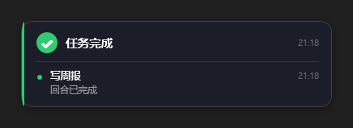
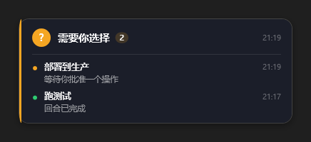
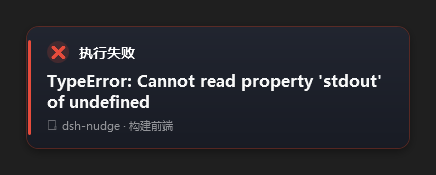
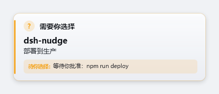
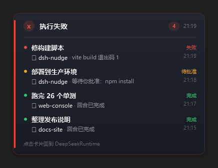
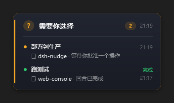
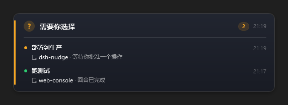

# dsh-nudge

[](https://github.com/HalfDone03/dsh-nudge/actions/workflows/selftest.yml)

DSH（DeepSeek Harness）插件：会话里**任务完成**、**需要你选择**、**执行失败**时，
在桌面**右下角**弹一张置顶小卡片提醒你处理。点一下卡片回到 DSH 窗口，并把这批提醒复制到剪贴板。

## 截图

<table>
  <tr>
    <td align="center"><br><sub>任务完成</sub></td>
    <td align="center"><br><sub>需要你选择</sub></td>
    <td align="center"><br><sub>执行失败</sub></td>
  </tr>
</table>

深色是默认样子；`theme: auto` 时跟着 Windows 的「应用模式」走，系统是浅色就出浅色卡片：

<table>
  <tr>
    <td align="center"><br><sub>浅色（<code>theme: light</code>，或系统是浅色时的 auto）</sub></td>
  </tr>
</table>

这些图不是效果图，是 `node scripts/selftest.mjs` 里用**同一个** WPF 渲染器在离屏窗口画出来的快照：
宽高与像素统计都写进了 `tools/snapshot-baseline.json`，版式一改、图没跟着改就会红。
卡片右下角弹出、不抢焦点，背景是你的桌面。

## 它解决什么

DSH 的回合经常跑很久，或者卡在等你批准/回答上，而你切到别的窗口去了。
这个插件在三种时刻各弹一张卡片（深色玻璃质感、圆角、不抢焦点、盖在任务栏上方）：

| 时刻 | 触发来源 | 卡片标题 |
| --- | --- | --- |
| 回合正常结束 | `session/event` → `turn/end`，`reason.kind` 为 `completed` / `max-tokens` | 任务完成 |
| 回合被策略拦截 | `turn/end`，`reason.kind === 'blocked'`（归档会话、过期 goal 等） | 执行失败 |
| 等你批准或回答 | `approval/request` 事件、`userQuestions.ask()` 被调用 | 需要你选择 |
| 回合或工具失败 | `turn/end` 的 `reason.kind === 'error'`、`tool/result` 报错 | 执行失败 |

几张卡片同时到达时，1.2 秒合并窗口内的事件会合成一张，标题取最严重的那个，右上角显示累计条数。

配置不用手改文件：`设置 → 插件 → nudge` 里能直接改停留时长、边距、三四类提醒开关、配色、静音时段，**改一项立刻生效**。
子代理会话（`delegationDepth > 0` 或有 `parentSession`）不单独弹，避免每个子任务都响一次。

## 版本

当前 **1.0.0**（2026-10-29）。逐条改动看 [CHANGELOG.md](CHANGELOG.md)，
带说明的发布记录在 [Releases](https://github.com/HalfDone03/dsh-nudge/releases)，
市场索引指向的具体提交写在仓库根目录的 `index.json`。

| 版本 | 日期 | 一句话 |
| --- | --- | --- |
| 1.0.0 | 2026-10-29 | 定版：接口冻结，此后只修 bug 发补丁版 |
| 0.3.3 | 2026-10-28 | 配置进设置、插件自带设置页、预览开关，弹窗更快 |
| 0.3.1 | 2026-10-26 | CI、快照像素基线与一条命令发版 |
| 0.3.0 | 2026-10-26 | 版式改成「项目 > 任务 > 原因」、默认停留 15 秒、全屏时不打扰、同一个时刻只留一张卡、点击聚焦提醒来源的那个实例 |
| 0.2.1 | 2026-10-24 | 工具失败按 `message.isError` 判定、审批卡片带上下文、标题走 `sessionTitle` 服务、排序与缓冲修正、子代理过滤 |
| 0.2.0 | 2026-10-23 | 卡片跟随 DSH 所在屏幕、右键只关闭、补不抢焦点与拖动缩放 |
| 0.1.0 | 2026-10-22 | 首版：三种时刻各弹一张置顶卡片，点击聚焦 DSH 并复制摘要 |

## 安装

两种装法：**有 Discover 入口就用 A（三步，推荐）**，没有就走 B / C。

### A. 插件市场里一键装（DSH 0.2.1+）

`Plugins → Discover → Index sources → 添加`，粘贴：

```
https://gcore.jsdelivr.net/gh/HalfDone03/dsh-nudge@main/index.json
```

回到 Discover 就能看到「DSH 轻推提醒」，点安装。市场自己写 profile、跑 pnpm，装完重开 DSH 生效。
索引是标准的 format 1，`source` 用 git 提交钉死（仓库根目录 `index.json` 的 `source.commit`，
就是 `v1.0.0` 的解引用提交），所以装到的一定是 `1.0.0` 那一版，不是 `main` 上的最新代码。

上面那条不通就换镜像（同一份内容，路径一样）：

```
https://fastly.jsdelivr.net/gh/HalfDone03/dsh-nudge@main/index.json
https://testingcf.jsdelivr.net/gh/HalfDone03/dsh-nudge@main/index.json
https://cdn.jsdmirror.com/gh/HalfDone03/dsh-nudge@main/index.json
```

两个坑：

- **别用 `raw.githubusercontent.com`**——国内常年连不上，一条索引读不出来整个 Discover 就是空的；
- **别用 `@v1.0.0`**——jsDelivr 对标签会永远返回打标签那一刻的 `index.json`，那份里的 `commit` 还是旧指针。用 `@main`。

这条要求机器上有 `git`（pnpm 拉 `git+https` 规格要用它）。没有 git 就走 C。

### B. 手动安装（有 git）

```powershell
git clone --branch v1.0.0 https://github.com/HalfDone03/dsh-nudge.git
cd dsh-nudge

# 只看计划，不写文件
powershell -NoProfile -ExecutionPolicy Bypass -File .\scripts\install.ps1 -DryRun

# 真正安装（会先备份 profile 的 package.json）
powershell -NoProfile -ExecutionPolicy Bypass -File .\scripts\install.ps1
```

### C. 没有 git

下这个压缩包解压，进目录跑 B 里那两条命令：

```
https://codeload.github.com/HalfDone03/dsh-nudge/tar.gz/refs/tags/v1.0.0
```

（npm 上装不到：`dsh-nudge` 这个名字已被别人占用。）

安装脚本做三件事，顺序不能省：

1. 往 profile 的 `package.json` 加一条 `file:` 依赖，并把 `dsh-nudge`
   追加进 `dsh.profile.bundles`；
2. 用 **DSH 自带的 pnpm** 在 profile 目录跑一次 `pnpm install`，把
   `node_modules\dsh-nudge` 建成 junction —— 只改 package.json 是不够的，
   Host 的 Loader 是按包名从 `node_modules` 里解析的，不落盘就会「装了但加载不到」；
3. 校验 `node_modules\dsh-nudge\package.json` 可读，并打印实际版本。

它**不碰** profile 的 `cordis.patch.yml`（那里放的是部署密钥），也**不会**重启 DSH。

**跑之前先退出 DeepSeek Harness**：pnpm 要重写 `node_modules`，Windows 上被占用的文件删不掉。
装完再启动 DSH 才生效——插件跑在 Host 进程里，Host 侧改动没有热更新。

DSH 自带 node 与 pnpm，但不同装法的路径不一样，脚本会挨个试：

| 装法 | 自带 pnpm 的位置 |
| --- | --- |
| 桌面版（安装包） | `<安装目录>\resources\runtime\primary-runtime\dependencies\pnpm\bin\pnpm.cjs` |
| 便携版 / 旧结构 | `%DSH_HOME%\dsh-runtimes\dsh-primary-runtime\dependencies\pnpm\bin\pnpm.cjs` |

安装目录从两个地方认：正在运行的 DSH 进程的可执行文件所在目录，和卸载注册项里的
`InstallLocation`。想直接指定，就设环境变量 `DSH_NUDGE_INSTALL_ROOT=<安装目录>`
（脚本会去它下面找 `resources\runtime\primary-runtime\dependencies`）。

两处都找不到、`PATH` 里也没有 `pnpm` 时，脚本**会把 `package.json` 回滚成备份再以退出码 1 结束**，
不会留一个「manifest 里写了插件、`node_modules` 里没有」的半装状态——那种状态下次启动 DSH 会加载失败。
`pnpm install` 自己失败、或者跑完之后 `node_modules\dsh-nudge\package.json` 仍然读不出来，也一样回滚：
要么装好，要么像没装过。
`-SkipPnpm` 可跳过这一步（只想改配置、稍后自己跑 `pnpm install --dir <profile>` 时用）。

卸载：

```powershell
powershell -NoProfile -ExecutionPolicy Bypass -File .\scripts\uninstall.ps1
```

安装与卸载都是幂等的，重复执行不会重复写入；每次改动前都会生成
`package.json.bak-<时间戳>`，写入失败或校验不通过会自动回滚。

「已经装过」要三方一致才算：`package.json` 里有依赖、`node_modules\dsh-nudge` 在、profile 的
`pnpm-lock.yaml` 里也记着这个包。只有前两条不算——旧版脚本手工建的 junction pnpm 不认，profile 里
下一次 pnpm 操作会把这个目录当杂物删掉（插件就消失了），插件管理器里点删除也清不掉它。碰到这种状态，
`install.ps1` 会重跑一次 `pnpm install` 把它收编到 pnpm 的账上。

## 配置

三个地方都能改，改完都立即生效：

- **插件自己的设置页**（推荐）：`设置 → 提醒弹窗`。这是本包的浏览器半身受（`client.js`），
  分组摆好了开关、停留、配色、静音与调试项，改一项立刻生效，**不用重启**。
- **`设置 → 插件 → nudge`**：宿主按 `Config` 里的 `.volatile()` 字段自动生成的表单，和设置页是同一份数据；
  因为本包自带了设置页，已经用 `configure({ auto: false })` 把这份自动表单关掉了，免得两处重复。
  （想让它出现，删掉 `lib/index.js` 里那句 `ctx.inject(["settings"], ...)` 即可。）
  插件的 `Config` 是一份 Schemastery schema，
  可改的字段都标了 `.volatile()`，宿主会把它们做成表单——改一项立刻生效，**不用重启**。
  写回的是当前 profile 的 `cordis.patch.yml`，所以加一条 `- id: nudge` 的 YAML 覆盖也没问题，
  两边看到的是同一份值。
- **手改 profile 的 `cordis.patch.yml`**，按 id 覆盖本包的默认值（下面这份就是全部字段）：

```yaml
- id: nudge
  config:
    staySeconds: 15        # 卡片停留秒数，1..600，默认 15；待选择的卡片另按三倍算（不少于 30 秒）
    margin: 16             # 卡片可见边框距工作区右下角的边距，默认 16（窗口的阴影会多伸出、贴边被裁掉）
    rememberPosition: true # 你拖过或缩过之后记住那个位置，下一张卡片回到那里；默认开
    placementFile: ''    # 位置记忆文件；留空 = %LOCALAPPDATA%\dsh-nudge\placement.json
    maxItems: 8            # 一张卡片最多列几条（1..20），超出显示「还有 N 条未展开」
    showWhenFocused: true  # DSH 在前台时也弹；设 false 则前台时不打扰
    suppressWhenFullscreen: true  # 前台是全屏应用（游戏/放映/演示）时整批不弹，默认开
    mergeWindowMs: 1200    # 合并窗口（毫秒），同一窗口内的多条事件合成一张卡
    alertOnToolError: true # 单个工具调用失败也算「失败」提醒
    muteRanges: ['22:00-08:00']  # 静音时段，支持跨零点
    theme: auto            # 配色：auto 跟随 Windows 的深浅色设置，也可以固定 dark / light
    debugPayload: false    # 调试开关：true 时把每次弹出的 payload 追加落盘
    debugFile: ''          # 落盘文件；留空 = %TEMP%\dsh-nudge-payloads.jsonl
    debugPreview: false    # 预览：true 时卡片常驻，可以拖动缩放，关掉时把位置和大小记住
    typography:            # 每一类文字的字号与颜色；留空 / 0 用主题默认（设置页里只在预览开着时显示这一组）
      title: { color: '', size: 0 }    # 标题
      project: { color: '', size: 0 }  # 项目名
      task: { color: '', size: 0 }     # 任务名
      reason: { color: '', size: 0 }   # 明细 / 原因
      status: { color: '', size: 0 }   # 状态词与计数胶囊
      time: { color: '', size: 0 }     # 时间
      more: { color: '', size: 0 }     # 展开提示
      footer: { color: '', size: 0 }   # 底部提示
    kinds:                 # 三类提醒各自开关
      completed: true
      needs_choice: true
      failed: true
```

非法配置会在插件加载时报错（`staySeconds` 越界、`muteRanges` 格式不对等），不会静默失效；
设置界面里填了非法值时，插件会继续沿用上一份能用的配置，不会因此把卡片全关掉。

例外是 `popupScript`（弹窗脚本路径）：它**没**标 volatile，改它得重启 DSH——换脚本意味着换进程行为，
不该在跑着的时候悄悄换掉。

### 设置页

`设置 → 提醒弹窗`（排在「插件」页后面，`order: 20`）分了六组：

| 分组 | 能改什么 |
| --- | --- |
| 总开关 | `enabled` |
| 提醒哪几类 | `kinds.completed` / `needs_choice` / `failed` |
| 什么时候弹 | `showWhenFocused`、`suppressWhenFullscreen`、`alertOnToolError` |
| 样子与位置 | `theme`（auto/light/dark 下拉）、`staySeconds`、`margin`、`rememberPosition` |
| 合并 | `mergeWindowMs`、`maxItems`、`muteRanges`（一行一段） |
| 每一项字体 | `typography.<角色>.color` 与 `.size`，8 类文字各一组（**只在预览弹窗打开时出现**） |
| 调试 | `debugPayload`、`debugFile`、`debugPreview`（预览弹窗） |

「每一项字体」这一组只在「预览弹窗」打开时出现：没有一张常驻的卡片当靶子，调字号只能靠猜。
改完对**所有**卡片生效，预览卡会当场重画一次（重画不加那 3 秒冷却），所以你改一格就能看到效果。

它和插件的 `Config` 是同一份数据，写回 profile 的 `cordis.patch.yml`；页面只在宿主提供
`slots` 与 `configForms` 两个服务时出现（`dsh.client.inject` 里声明了），浏览器半身在
`/plugins/dsh-nudge/client.js`。

## 视觉与排版

两条路径：只有一条提醒时走“单条”，两条以上走“清单”。**两种排版都是项目名最大**——先看清是哪摊活，再看是哪个任务，最后才是报了什么。

单条（失败示例）：

```
────────────────────────────────────────────
▌ ✖ 执行失败 · 20:09

 dsh-nudge
 修构建脚本
 失败：vite build 找不到入口模块
 点击卡片回到 DeepSeek Harness
────────────────────────────────────────────
```

- `▌` 左侧 3px 强调色竖条，颜色跟随类型（完成 `#2ECC71` / 待选择 `#F5A623` / 失败 `#E74C3C`）；整张卡的外框也跟着泛色。
- `dsh-nudge`：项目文件夹名，15.5 半粗，**全卡最大的字**，一行截断——扫一眼就知道是哪摊活。名字前面不放图标：那个位置原来是 Segoe MDL2 Assets 的文件夹字形，小字号下就是个方块，删掉还把 16px 还给了截断宽度。
- `修构建脚本`：任务名，12.5，第二行，最多三行（超过 54px 按整字截断并补 `…`）。
- `失败：…`：第三行，状态词 + 一句话原因，10.5；失败和待选择带同色淡底板，完成只写「完成」。

多条（4 条、3 个项目）：

```
────────────────────────────────────────────
▌ ✖ 执行失败 ④ · 20:09
 ──────────────────────────────────────────
 ● dsh-nudge · 失败 · 20:09
   修构建脚本
   vite build 退出码 1
 ● web-console · 完成 · 20:02
   跑完 26 个单测
────────────────────────────────────────────
```

- 每条三行：项目（15 半粗，最大）→ 任务名（12.5）→ 明细（10.5）；右侧竖排「状态 + 时间」。
- 明细为空的条目只排两行（项目 + 任务名）——右侧已经写了「完成」，再补一句「回合已完成」是废话。
- 超出 `maxItems` 时底部出现「还有 N 条未展开」（文案由 JS 下发，脚本保持纯 ASCII）。

真图（同一套 payload，4 条提醒 / 3 个项目）：



宽度不是写死的：拖窄了明细自己折行，拖宽了一行就放得下（最小 260，没有上限）。

<table>
  <tr>
    <td align="center"><br><sub>拖到 300 宽：明细折行</sub></td>
    <td align="center"><br><sub>拖到 520 宽：一行放下</sub></td>
  </tr>
</table>

- 字体用 `Microsoft YaHei UI → Segoe UI → Arial` 回退链，中文不再掉进 Segoe UI。
- 高度由内容测量决定（`Measure` + `DesiredSize`），长明细换行不会撑破卡片，也不会留白。
- 出现时 180ms 淡入 + 10px 上滑；鼠标移进卡片边框提亮，同时重置停留计时。
- 停留时长：条目越多越久（`staySeconds + 2 × (条数-1)`，默认 15 秒起）；「需要你选择」再乘三且不少于 30 秒。
- 卡片内顺序：先按严重度（失败 > 选择 > 完成），同级别按时间倒序。
- `popup.ps1` 保持纯 ASCII，所有中文文案（标题/展开提示/底部提示）由 `index.js` 下发的 payload 提供。
- **深浅两套配色**：`theme: auto` 读 Windows 的「应用模式」自己选（系统浅色就出浅色卡），也可以固定 `dark` / `light`；调试时还能用 `-Theme` 参数临时覆盖。浅色不是把深色反过来——分割线、描边、阴影、状态色都是单独配的一套值。

## 交互

- **可拖动、可缩放，并且记得住**：按住卡片拖动即可换位置；把鼠标移到四边或四角（光标会变成缩放箭头）拖动即可改大小，最小 260×118。
  没动过的时候它贴着工作区右下角（`margin` 量的是**看得见的边框**，窗口的透明阴影会多伸出 14px 被屏幕边缘裁掉）；
  一旦你拖过或缩过，新的物理坐标就记进 `%LOCALAPPDATA%\dsh-nudge\placement.json`，之后的卡片回到那个位置。

- **想认真调就开预览**：设置 → 提醒弹窗 → 调试 → **预览弹窗**。打开后立刻弹一张常驻的卡片，它不倒数、不被 watchdog 收走、也不会被新提醒顶掉；你可以慢慢拖动、慢慢缩放到满意，关掉开关时它自己关窗，把位置和大小一起记进 `%LOCALAPPDATA%\dsh-nudge\placement.json`。没动过的卡片不会写这个文件——「记住的位置」只有在真的动过之后才有意义。
  记的位置如果已经不在任何显示器上（拔了副屏、改了分辨率），自动回落到右下角；删掉那个文件即可恢复默认。卡片是透明的无边框窗口，所以缩放走的是 `ReleaseCapture` + `WM_NCLBUTTONDOWN`，交给系统原生缩放循环处理。
- **内容自适应**：卡片宽度不再写死，文字、清单、项目标签都按当前可用宽度重新换行排版；拖大不会留白，拖小自动折行。
- **一眼看清是哪摊活**：字最大的永远是项目文件夹名，其次是任务名，最后才是一句话的成败原因（`失败：…` / `待你选择：…` / `完成`）。多条提醒逐条三行排版，右侧竖排「完成 / 待你选择 / 失败 + 时间」。不加滚动条，卡片按内容长高，窗口最小高度也跟随内容。
- **不打扰**：卡片不抢焦点、不抢鼠标——它是 `WS_EX_NOACTIVATE` 窗口，永不会被激活；只在指针真的移动超过 4px 时才开始拖动，纯点击不会进入系统拖动循环；弹出后 320ms 内落下的点击会被忽略。失败时整张卡的外框会泛红，扫一眼就知道出了事。
- **跟着你走**：卡片出现在 DSH 窗口所在的那块屏幕（取不到就退到光标所在屏，再退到主屏）；右键只关掉卡片，不切焦点、不写剪贴板。
- **一张卡要多久**：进程启动到看得见约 560ms（PowerShell 自身启动就占 ~107ms）。原生类型只编译一次，
  之后从 `%LOCALAPPDATA%\dsh-nudge\bin\native-<哈希>.dll` 读回来（191ms → 45ms）；WPF 程序集推迟到真要画卡时才加载，
  被抑制时不碰；离屏快照从 776ms 降到约 450ms。想自己看每段耗时，加 `-Trace`：
  `trace card 224ms` 这样的行会写到 **stderr**（stdout 留给宿主解析状态协议）。- **自动消失**：`staySeconds` 秒后淡出（到点关闭，无残留进程）。
- **点一下**：把 DSH 窗口切到前台，并把提醒内容（标题 + 明细）放进剪贴板。
  DSH 的 Web GUI 是单页应用，没有「按会话 id 直达」的 URL，所以只能聚焦窗口 + 复制线索。
- **同一时刻只有一张卡**：按用户会话挂一个命名互斥量（`Local\dsh-nudge-card`），新的一批提醒通过 `Local\dsh-nudge-replace` 事件请上一张退场（200ms 内响应），再接管右下角——多开几个 DSH 也不会叠一屏。拿不到命名对象时退回旧行为（每批一张卡），不会因此不弹。
- **全屏时不打断你**：前台是全屏应用（游戏、放映、演示）就整批不弹，`suppressWhenFullscreen` 默认开。判定有两道：先问系统「现在适合打扰吗」（`SHQueryUserNotificationState`），再看前台窗口是否正好盖满物理屏——后者能抓住「无边框全屏」的游戏和 F11 浏览器。桌面本身（`Progman` / `WorkerW`）、任务栏和最大化窗口都不算全屏：它们的矩形同样铺满整块屏，但盖不住任务栏。两个检查都是**只读查询**：不挂钩子、不抓输入、不碰游戏窗口，鼠标和键盘完全不受影响。被跳过的批次直接丢弃（不排队），状态行走 `{"type":"suppressed","reason":"fullscreen"}`。

## 发布

包已按可发布形态配好：`type: module`、`main`/`exports`、`dsh.bundle.patch`、
`files` 白名单（21 个文件、约 298 KB，只含 `lib`/`scripts`/`cordis.patch.yml`/README/VERIFY/CHANGELOG/`screenshots/*.png`；`docs/` 只留在仓库里）、
`engines: { node: ">=20.3.0", dsh: ">=0.2.1-rc.2" }`、`os: ["win32"]`、`publishConfig.access: public`。

```powershell
npm login
npm publish            # 名字带 scope 时用 npm publish --access public
```

发版走脚本，别手敲（手敲过几次，漏过踩 tag、漏过建 Release）：

```powershell
# 本机默认 ExecutionPolicy 不让直接跑 .ps1，所以用 powershell -File 的形式
powershell -NoProfile -ExecutionPolicy Bypass -File .\tools\release.ps1 -Version 0.3.1 -DryRun
powershell -NoProfile -ExecutionPolicy Bypass -File .\tools\release.ps1 -Version 0.3.1
```

它按顺序做：挑 node 跑语法检查与 190 项自测 → 改 `package.json` 版本 → 把 `CHANGELOG.md` 顶部的
「未发布」换成本版标题 → 更新本文件里的「当前版本」与版本一览表格 → 提交 → 打附注 tag → 把 `index.json`
的 `versions[0]` 三字段指向这个提交并再提一条
`chore(release): 索引指向 x.y.z 最终提交 (<hash>)` → `gh release create --latest` → push `main` 与 tag。
`-NoPush` 只做本地、`-NoRelease` 免建 Release、`-SkipChecks` 跳过自测、`-Title "…"` 换掉 tag 里那句摘要
（默认取该版 CHANGELOG 第一条 bullet，去掉 markdown 记号后截 60 字）。

它做的事就是下面这三条**市场索引与发布记录**的收尾（`index.json` 在仓库根目录，jsDelivr 的 `@main` 直接读它）：

1. 改 `package.json` 的 `version`、把 `CHANGELOG.md` 顶部的「未发布」换成本版标题，提交后打 tag（`v<版本>`）；
2. 再提一条 `chore(release): 索引指向 x.y.z 最终提交 (<hash>)`，把 `index.json` 的
   `versions[0].version` / `publishTimestamp` / `source.commit` 指向上一步那个提交；
3. 建 GitHub Release：`gh release create v<版本> --title "v<版本> — 一句话" --notes-file <该版本的 CHANGELOG 段>`，
   最新一版再加 `--latest`。**只 push git tag 不会生成 Release**，仓库首页的「Releases」区块会是空的。

`@main` 上永远是最后一条索引，所以用户点「安装」拿到的就是 `source.commit` 钉死的那一版；
这也是为什么上文的坑里说「别用 `@v<版本>`」——标签里的 `index.json` 会停在当时那个指针。

发布前自检（`release.ps1` 里已经包含，手工时照抄）：

```powershell
& $node --check .\lib\index.js
& $node .\scripts\selftest.mjs      # 190 项全绿；CI 上跑的是 --no-live（167 项）
```

三条硬要求，少一条装上就是坏的：

1. `dsh.bundle.patch` 必须指向真实存在的 patch 文件——没有它 DSH 不认这是组合包；
2. `cordis.patch.yml` 里的 `name` 必须是包名，`id` 才是实例 id；
3. `engines.dsh` 写错范围会在 pnpm 之前被拦掉（`incompatible-version`），
   确认没问题可用 `dsh plugin allow-version <包@版本> --dsh-version <运行时> --accept-risk` 豁免，
   但插件升级或 DSH 升级都不会继承这条豁免。

## 更新

| 场景 | 做法 | 要重启 DSH |
| --- | --- | --- |
| 本地 `file:` 依赖改了代码 | 重新 `install.ps1`（或插件页重装） | 要 |
| 本地 `link:` 依赖改了代码 | 直接改 `lib/*` | 要 |
| 只改配置（`config`） | 设置 → 插件 → nudge 里改（写回 profile patch） | 不用，改一项立刻生效 |
| 改 `popupScript` | 改 profile patch | 要（它故意不是 volatile） |
| 发布新版 | 改 `version` → `npm publish` → 插件页「更新」 | 要 |
| 回滚 | 装回旧版本，或恢复 `package.json.bak-<时间戳>` | 要 |

registry 安装是 `saveExact`（精确版本），不改版本号重装拿不到新代码。

怎么知道有没有新版：看 [Releases](https://github.com/HalfDone03/dsh-nudge/releases)（每版都有一句话摘要），
或者直接看 [CHANGELOG.md](CHANGELOG.md)。市场里装的话，插件页出现「更新」按钮就是索引里已经有更高版本。

## 自测

不依赖真实会话，直接驱动插件逻辑与弹窗脚本：

```powershell
. .\scripts\dsh-deps.ps1                    # 和装/卸脚本共用同一套「找 DSH 自带的 node」
$node = (Find-DshDependencies).Node
if (-not $node) { $node = 'node' }          # PATH 里已有 node 就直接用
& $node .\scripts\selftest.mjs              # 190 项，含真起窗口与双卡抢槽位
& $node .\scripts\selftest.mjs --no-live    # 167 项，跳过需要交互桌面的两段（CI 跑这个）
```

当前 **190 项全绿**，覆盖：配置校验与默认值、实时配置（设置里改完立即生效）、静音时段（含跨零点）、事件合并计数、
严重度排序、三类开关、真起弹窗并收到 `{"type":"shown"}` 与右下角坐标、dispose 后无孤儿进程、
三种状态各渲染一张 436px 宽快照，外加一张 4 条合并的清单快照（`screenshots/multi.png`，尺寸、非空与像素基线比对），以及一组源码静态约束——
脚本必须纯 ASCII、项目名前不许出现图标字形、字号阶梯必须是「项目 > 任务 > 原因」、
单卡槽位、剪贴板回报、全屏抑制的两道判断与调试开关不许被删。
最后一组会**真跑两张卡**：A 占位拿到 `slot:"owner"`，B 上来后 A 收到 `closed/replaced`、
B 标记 `slot:"replaced"`，验证「同一时刻只有一张卡」，顺带验证 payload 落盘。

设置页那 15 项是**离线**跑的：用 `node:vm` 造一个假的 `window.__ModuleLoader__` 把 `client.js`
加载起来，再用假 React 调它的 factory 与页面组件，断言「注册进 `settings.section`、id 是 `nudge`、
顺序 20、导航标题是中文、六个分组与 16 个控件都在、写 `kinds.completed` 走多段路径并带 revision」。
所以浏览器半身坏了不用真开 DSH 就能发现。

快照有像素基线（`tools/snapshot-baseline.json`）：宽高必须一致，`distinct/dark/text/accent`
允许 ±2%。改了版式、确认新样子是对的之后跑一次：

```powershell
& $node .\scripts\selftest.mjs --update-baseline
```

忘了更新就会红，省得 README / VERIFY 里的数字自己漂。CI（`.github/workflows/selftest.yml`）
在每次 push / PR 上跑 `--no-live`，并检查 `package.json` / `CHANGELOG` / `index.json` 三处版本号是否自洽。

想核对「卡片上到底写了什么」（比如怀疑标题取错），把 payload 落盘打开：

```powershell
$env:DSH_NUDGE_DEBUG_PAYLOAD = "1"
$env:DSH_NUDGE_DEBUG_FILE = "$env:TEMP\nudge-payloads.jsonl"   # 可省略，默认写到临时目录
```

之后每次弹卡都会往该文件追加一行 JSON（`{at, payload}`）；写入失败只留一条 debug 日志，不影响弹卡。

快照模式可以单独跑，不需要会话也不需要屏幕：

```powershell
powershell -NoProfile -ExecutionPolicy Bypass -STA -File .\lib\popup.ps1 `
  -Snapshot .\screenshots\custom.png -PayloadB64 <base64 的 JSON>
```

## 文件

```
dsh-nudge/
├─ package.json          插件包声明（dsh.bundle.patch、dsh.client 指向浏览器半身）
├─ client.js             浏览器半身：注册「设置 → 提醒弹窗」那一页（经典脚本，无需构建）
├─ index.json            市场索引（format 1）：版本号 + 钉死的 source.commit
├─ cordis.patch.yml      bundle patch：把插件插进 Host 的插件图
├─ CHANGELOG.md          逐版改动（版本号以这里为准）
├─ lib/
│  ├─ index.js           插件逻辑：事件钩子、合并去重、配置校验、helper 进程管理
│  └─ popup.ps1          WPF 弹窗（纯 ASCII 脚本，含快照渲染模式）
├─ scripts/
│  ├─ install.ps1        注册进 profile（幂等、备份、失败回滚）
│  ├─ uninstall.ps1      从 profile 摘除
│  ├─ dsh-deps.ps1       两个脚本共用：找 DSH 自带的 node + pnpm
│  └─ selftest.mjs       190 项自测（`--no-live` 167 项、`--update-baseline` 重写像素基线）
├─ tools/
│  ├─ release.ps1        一条命令发版（自测→版本号→tag→索引指针→Release→push）
│  └─ snapshot-baseline.json  快照像素基线，改了版式要跟着重生
├─ .github/workflows/selftest.yml  CI：windows-latest 上跑 --no-live 与版本号自洽检查
├─ screenshots/          三态卡片图（纯色底，无桌面内容）
└─ docs/api-notes.md     事件源与弹窗选型的取证笔记（带源码行号）
```

## 实现要点（踩过的坑）

- **Host 进程里没有 Electron**：DSH 的 Host 是 `ELECTRON_RUN_AS_NODE` 子进程，拿不到
  Electron 的 `Notification`，所以弹窗交给 `powershell.exe -STA` 的 WPF 窗口。
- **一次性 helper，不用常驻 + stdin**：Windows PowerShell 5.1 的 `[Console]::In`
  在重定向管道下会把命令压到下一次写入才交付（实测延迟数秒乃至挂死）。
  现在每条提醒起一个一次性进程，payload 走命令行 base64，到点或点击即退出。
- **状态行必须写裸 stdout**：`Write-Output` / `[Console]::Out` 在 dispatcher 回调里
  不会及时冲刷，改用 `[Console]::OpenStandardOutput()` 直接写字节。
- **窗口可能被隐藏启动**：宿主用 `windowsHide` 拉起 helper 时，首个 WPF 窗口会带着
  隐藏标志出现，`Show()` 后要 `ShowWindow(SW_SHOWNOACTIVATE)` + `SetWindowPos(HWND_TOPMOST, …NOACTIVATE)` 强制可见。
- **脚本保持纯 ASCII**：PowerShell 5.1 会把无 BOM 的 UTF-8 脚本按 ANSI 读，
  中文注释会乱码甚至语法错误；`popup.ps1` 里没有非 ASCII 字符。所有中文（含点击后写进
  剪贴板的抬头）都由 `lib/index.js` 的 payload 下发。
- **高 DPI 要按显示器算**：`MonitorInfo.rcWork` 是物理像素，而 WPF 的 `Left/Top` 是 DIP，
  系统级 DPI 感知下这两者在缩放屏上不同量纲，卡片会偏出角落。helper 先申请 per-monitor-v2
  感知（失败逐级降级到 per-monitor / system），边距按目标屏 DPI 放大，`Loaded` 后再用
  物理像素 `SetWindowPos` 钉一次；100% 单屏下这次校正是 no-op。
- **点击要聚焦「这个」实例**：helper 的直接父进程是 Host，和 Electron 主进程同名却没有窗口，
  所以「按进程名取第一个有窗进程」在同时开两个 DSH 时会切错窗口。改为用 Toolhelp32 快照回溯
  祖先链，取最外层的同名有窗进程（逐层 spawn CIM 要 530ms，快照是 1ms 级）。
- **一张卡只能有一个主人**：每个 helper 都算同一个右下角，两批提醒同时到就会叠在一起，各自的
  计时和点击目标互不知情。`Local\dsh-nudge-card` 互斥量选主，后来者 Set 一下
  `Local\dsh-nudge-replace` 事件把在位的那张请走（200ms 轮询、UI 线程上关窗），再接管位置。
- **剪贴板会失败，别装作成功**：`Set-Clipboard` 在别的程序占着剪贴板时会抛异常，旧代码把它包在
  空 `catch` 里，用户以为复制了其实没有。现在关窗时补一条 `{"type":"closed","reason":"clicked","clipboard":true|false}`
  状态行，宿主日志里能看见到底写没写成。
- **非 Windows 直接不注册**：卡片是 powershell + WPF 画的，`package.json` 的 `os` 只在安装期拦，
  开发态跨平台跑会每个回合 spawn 失败刷警告，所以 `createPlugin` 在非 win32 上早退。
- **要写中文的 PowerShell 脚本得存成 UTF-8 with BOM**：5.1 会把无 BOM 的 UTF-8 当 ANSI 解，
  中文串会把它后面的引号吃掉，`Parser::ParseFile` 报一堆「意外的标记」。
  `lib/popup.ps1` 因此干脆保持纯 ASCII；`tools/release.ps1` 有中文提示，所以带 BOM。
- **阴影是窗口的一部分，定位要按可见边框算**：卡片窗口是透明的，`ShadowPad = 14` 的 halo 让可见边框比窗口内缩 14px。
  只按窗口贴角会让边框离屏幕边缘变成 `margin + 14`，看上去「没对齐」；所以窗口向右下多伸出 `ShadowPad`，把阴影交给屏幕边缘裁。
- **版式不能只靠人眼盯**：快照的尺寸和像素统计固化在 `tools/snapshot-baseline.json`，
  改完版式忘了重生基线，自测直接红——比等 README 里的数字和实际图悄悄分叉强。
- **浏览器半身不是 ESM，也不需要构建**：`client.js` 是一个包在
  `window.__ModuleLoader__.load({ id, factory })` 里的经典脚本，宿主只负责把文件挂到
  `/plugins/<包名>/client.js`；`require` 只能拿到共享模块表里的包（这里只要 `react`），
  所以写成手写 `createElement`、不引 JSX、不引第三方库。想让 DSH 认它，`package.json` 得同时给
  `exports["./client"]` 和 `dsh.client.platform: "web"`。
- **设置页的写操作只有一条路**：`configForms` 的 `set(field, value)` 只吃单段路径，
  `kinds.completed` 这种必须走 `mutate([{ op: "set", path: ["kinds", "completed"], value }], revision)`，
  而且 revision 要用 `getSnapshot()` 里那份——写旧了会被设置服务当冲突拒掉。
- **自带设置页就把自动表单关掉**：`ctx.settings.configure({ auto: false }, ctx.fiber)`，
  否则「插件」页和「提醒弹窗」页会出现两份同样的表单，用户改哪份都糊涂。
- **`$script:` 变量别和参数撞名**：主题状态最早写成 `$script:Theme`，而脚本本身有个 `-Theme` 参数，
  于是给 `$script:Theme` 赋值等于把参数改了，第二次解析时 CLI 的浅色反过来压住了 payload 的深色。
  改成 `$script:ThemeName` 才对。PowerShell 里给 `$script:x` 赋值，改的是同一个作用域里的 `$x`。
- **预览卡不能靠杀进程收场**：宿主写一个 stop 文件，卡片每 250ms 看一眼，看到就自己关窗——
  这样 `Closing` 事件一定会跑，位置和大小才写得下来。直接 `taskkill` 的话窗口还在原地，
  下一次读到的就是上一次的坐标。
- **只有真的动过才写位置文件**：`Save-CurrentPlacement` 先看 `placementDirty`（拖动/缩放结束时置位），
  否则每张卡关掉都把「右下角」写成 `remembered`，位置文件既没意义，也让「从没记过位置」验不出来。
- **调试开关要能改配置，不只是环境变量**：`debugPayload` / `debugFile` 进了插件配置，
  真机复现「卡片显示了不相干文字」时，打开它就能拿到每次弹出的原始 payload，
  不用重启带环境变量的宿主。
- **配置要能被设置界面收进去，`Config` 就得是 Schemastery schema**：`dsh-settings` 只认
  「`Config` 有 `toJSON`、至少一个字段带 `.volatile()`、条目处于 active」的插件，命名空间取 entry 的 id，
  然后渲染在侧栏「插件」页——不用自己写客户端 bundle。早先手写的 StandardSchema 能被 cordis 校验，
  但 `toJSON` 一个都没有，所以设置里根本看不见。
- **volatile 是「就地换引用」，插件不会被重新 apply**：宿主只把 `{ get(), [cosmokit.volatile.write] }`
  里的值换掉，所以插件不能在自己 `apply` 时把配置拍成快照。现在的做法是 `createPlugin` 里换成
  `liveConfig(raw)`——每次读属性才展开引用、重新校验，所以设置里改完立刻生效；填了非法值就沿用上一份
  能用的配置，不至于因为手滑把一个字段写坏而整晚没提醒。
- **`@deepseek-ai/schemastery` 不能硬依赖**：它在 npm 上，但插件作者的机器上不一定装（profile 里就没有），
  而静态 `import` 解析不到会让模块求值直接失败。改成顶层 `await import(...)` + 失败回落手写校验器：
  宿主里生成带 volatile 的 schema（能进设置），纯 node 跑自测时退回校验器。
